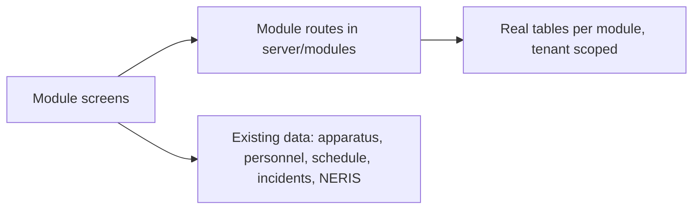

# Demo Week Build Plan (about 15 hours, on staging)

The full build-out plan (`operations_modules_plan_298c9270.plan.md`, Stages A-I) is still the long-term guide. This plan is the shortcut for the demo. Each step says what is real now and what is deferred.

## Decisions from your latest answers
- **Storage:** Cloudflare R2.
- **Libraries:** all approved.
- **Personnel IDs:** in the first stage of the full build, plus a deeper Personnel Management area (wages, and one settings section per enabled module).
- **Notifications:** in-app and email, adjustable in each user's settings.
- **Display board:** the newest call stays on top. The emergency screen reverts after 60 seconds by default (editable per board). Sound is on by default. One board can show on many TVs, and a station can have many boards. Each board chooses "all department calls" or "only my district."
- **Inventory:** signature is a typed name (pre-filled with the signed-in name) plus a typed PIN. Admins build templates and users complete checks.
- **Maintenance:** users create requests and report broken equipment. Admins or authorized people close them once the required details are entered.
- **Timesheets and pay:**
  - Call pay is created when the NERIS report is Exported.
  - Overtime rules are set per department: hours beyond the scheduled shift, or over 40 hours a week.
  - Exports are a general spreadsheet plus user-made export templates.
  - Members see the deduction lines on their own pay.
- **Policies:**
  - Uploaded PDFs are converted into the editor. DTB means Daily Training Bulletin.
  - Acknowledging is one click, and everyone must re-acknowledge a republished policy by default.
- **Fire Prevention:**
  - Properties can be filtered by commercial or residential.
  - Properties can be bulk-imported from our spreadsheet template, one property per row.
  - **Building photo:** Google does not allow saving Street View images (checked 2026-11-25), but it does allow saving the Street View camera position (the panorama ID).
    - A "Use this view as thumbnail" button saves that camera position. The image is still loaded live from Google each time: 10,000 free a month, then about $7 per 1,000.
    - A photo the department uploads always replaces it and costs nothing.
  - **Property screen layout:** top tabs are Details and Contacts only. The lower tabs are Incidents, Pre-Plans, Inspections, Permits and Alarm Requests. Permits and Alarm Requests show "Coming soon".
  - **Pre-plans:** a basic template and a complex template. Every field is optional. The ESO field list comes later.
  - The NERIS Person/Owner section gets "Add from Properties" (Name - Title).
  - Investigations, Permits and Smoke Alarms stay parked.
- **Maps:**
  - Google Maps.
  - Geofences fill in the district automatically.
  - A geofence (for example the trailer park) opens its pre-plan and layout when clicked.
  - The marker editor follows your current program: right-click to add, click to edit, drag to move, delete from the edit form, and a search bar.
- **Call locations:** Kankakee County CAD does not send latitude and longitude, so calls arrive with an address only (see "How call locations work" below).
- **Look and feel:** the current app is already consistent, so new pages copy the existing page styles. The only UI addition is a button to hide the sidebar for a full view.
- **Street View "screenshot":** not possible. The browser blocks a page from copying Google's images (a security rule), and Google's terms forbid saving Street View pictures. Instead:
  - "Use this view as thumbnail" saves the camera angle, and the picture loads live.
  - A **Take Photo** button opens the camera directly on a phone or tablet, so the inspector can snap the building on site in one tap.
- **Branch:** `submenu/neris-golive-cifpd` deploys to staging.
  - Demo work happens on a new branch `feature/demo-modules`, created from it.
  - Each finished step is merged into `submenu/neris-golive-cifpd` only after lint and build pass, so CIFPD's NERIS go-live testing on staging isn't disturbed by half-finished work.
- **Agent:** the build will be done with Grok 4.7. This plan must stand on its own (see "Handoff for the next agent").

## How call locations work (no permanent saving needed for calls)
1. A call arrives with only an address, for example "123 Main St". To put it on the map, the app has to turn the address into a map point. This is called geocoding.
2. The app asks Google for that point **when the call is shown** (emergency screen, display board, incident page). Google allows keeping it for up to 30 days, so the app stores it briefly on the incident and doesn't ask again on every screen refresh. Nothing is kept forever.
3. The emergency screen centers the map on the call, shows nearby markers (hydrants, pre-plans, hazards) when zoomed in, and has a **Directions** button. The button opens Google Maps directions from the user's current location. It is free.
4. **What is saved permanently** is only what the department creates itself: markers placed on the map, geofence shapes, and property pins. These are your own data, not Google's.
5. **The one exception is district auto-fill.** Google's terms forbid using its points for "is this point inside this geofence" checks. So the server makes a second, free lookup with the US Census Geocoder (no account or key needed) and uses that point for the district check. For the demo this is optional; the district can be picked by hand.

## Database approach: real, permanent tables (decided 2026-11-25)
The user chose real tables now, so nothing has to be rebuilt before production. One temporary shared table was considered and rejected.

**The rule that keeps this fast:** every table has the columns the app searches, sorts or links on, plus one `detailsJson` column for fields that are still changing (for example the Complex pre-plan fields or the inspection results). New fields go into `detailsJson` without a database change. They become real columns later only if the app needs to search on them.

Every table also has `id`, `tenantId` (with `@@index([tenantId])`), `createdAt`, `updatedAt`, `createdBy`, `updatedBy` and `deletedAt` (soft delete). All of them live in [prisma/schema.prisma](prisma/schema.prisma).

**Tables, built in the step that uses them (one migration per step):**
- **W1 Maintenance:**
  - `MaintenanceRecord`: recordNumber, assetKind (apparatus or equipment), assetRef (the unit ID until A1), typeId, status, priority, dueDate, completedDate, performedByKind, performedByName, vendorId, outOfService, detailsJson.
  - `MaintenanceType`: tenantId (empty for system defaults), name, category, nfpaStandard, defaultFrequency, enabled.
  - `Vendor`: name, contact, phone, email, website, services.
  - `MaintenanceCost`: recordId, description, amount, vendorId.
  - `PmSchedule`: name, typeId, assetKind, assetRef, frequency, nextDueAt, active.
  - `Equipment`: name, equipmentType, serialNumber, locationRef, status.
  - `Comment`: ownerType, ownerId, body, authorName. Shared by every module.
- **W2 Maps:**
  - `MapMarkerType`: name, icon, color.
  - `MapMarker`: markerTypeId, latitude, longitude, label, detailsJson.
  - `Geofence`: name, description, kind, color, parentId, geometryJson, linkedPropertyId, linkedPrePlanId.
- **W3 Display board:**
  - `DisplayBoard`: name, stationName, callFilter, filterGeofenceIds, takeoverSeconds (default 60), soundOn (default true), layoutJson.
  - `Announcement`: title, body, important (shows in the red banner), startsAt, endsAt.
  - `DisplayEvent`: title, startsAt, detailsJson. Replaced by the Calendar later.
  - The incident map point uses two new columns on `Incident`: `latitude`, `longitude` and `geocodedAt`, cleared after 30 days.
- **W4 Inventory:**
  - `Kit`
  - `ChecklistTemplate` and `ChecklistTemplateVersion` (itemsJson)
  - `ChecklistAssignment`
  - `ChecklistSubmission`: resultsJson, typed signature name, status
- **W5 Dashboard:** `DashboardLayout`: userId (empty for the department default), layoutJson.
- **W6 Policies:**
  - `PolicyCategory`
  - `Policy`
  - `PolicyVersion`: contentJson, plus the PDF file once storage exists
  - `PolicyAssignment`
  - `PolicyAcknowledgment` (add-only)
  - `PolicyTemplate` and `PolicyTemplateItem`
  - `PolicyRandomRule`
- **W7 Fire Prevention:**
  - `Property`: address fields, normalizedAddress, propertyType, occupancyType, latitude, longitude, streetViewPanoId, streetViewHeading, streetViewPitch, photoRef, detailsJson.
  - `PropertyContact`: name, role, isPrimary, phone, email, address.
  - `PrePlan`: propertyId, template (basic or complex), detailsJson.
  - `Inspection`: number, propertyId, type, receivedDate, scheduledAt, status, leadInspector, otherInspectors, district, station, shift, unit, reason, resultsJson.
- **W8 and W9, if time allows:**
  - `PayProfile` and `PaySettings`
  - `TimeEntry` and `DeductionRule`

  These are keyed by personnel name until the full plan's step A2 adds permanent personnel IDs.

**Routes:** each module gets its own routes, for example `/api/maintenance/records` and `/api/geofences`, in a new file per module under `server/modules/` (for example `server/modules/maintenance.mjs`), registered from [server/neris-proxy.mjs](server/neris-proxy.mjs).
- Every query filters on `request.tenant.id`.
- Every route is mapped in `permissionForRequest` in [server/auth/permissions.mjs](server/auth/permissions.mjs).
- New permission keys: the full list is in W0.3.

**Not used:** `DepartmentDetails.payloadJson`. Its save replaces the whole JSON, so concurrent edits would wipe each other.

**Approval:** these tables are approved by the user in principle. Each step's migration is still shown to the user before it is applied to staging.



## What is deferred until after the demo
- Device pairing keys for TVs. For the demo, the board runs in a signed-in browser tab. Its 15-30 second refresh keeps the session alive, but closing the browser signs it out.
- Moving apparatus, stations and personnel into real tables. The demo reads the existing `payloadJson` lists read-only.
- R2 file storage. For the demo, small files (PDFs and photos under about 3 MB) are stored inside the record. R2 comes right after the demo.
- Live CAD updates, email notifications and PDF generation on the server.

## Steps (in your priority order, with rough hours)

### W0. Foundation (about 1.5 hours)
- **Summary:** the groundwork every later step builds on.
  - a new branch
  - one shared table for comments
  - the new permission names
  - a folder for the new server code
  - the menus and blank pages for every demo module

  After W0, each new menu item opens a page that says "Coming in this build" instead of "Not built". No real features yet.
- **What the user sees when W0 is done:**
  - The new menu items are clickable and open blank pages.
  - The Policies menu appears in the sidebar.
  - Nothing that already works has changed.

**W0.1 Branch.** From `/Users/jeremywichtner/CursorProjects/FireUltimate-V1.0.0.0`:
```bash
git checkout submenu/neris-golive-cifpd
git pull
git checkout -b feature/demo-modules
git push -u origin feature/demo-modules
```

**W0.2 Comment table (the only database change in W0).**
- In [prisma/schema.prisma](prisma/schema.prisma), add a `Comment` model (it will be shared by every module):
  - `id` String `@id @default(cuid())`
  - `tenantId` String, a relation to `Tenant` with `onDelete: Cascade` (copy how `TradeRequest` links to `Tenant`)
  - `ownerType` String (for example `maintenanceRecord` or `inspection`)
  - `ownerId` String
  - `body` String
  - `authorUserId` String?
  - `authorName` String
  - `createdAt` DateTime `@default(now())`
  - `updatedAt` DateTime `@updatedAt`
  - `deletedAt` DateTime?
  - `@@index([tenantId, ownerType, ownerId])`
- Add the matching `comments Comment[]` line to the `Tenant` model.
- **Migration:**
  - Create the folder `prisma/migrations/20261126090000_add_comment/` with a `migration.sql` file.
  - Write the SQL by hand in the same style as `prisma/migrations/20261103210000_add_trade_request/migration.sql`: the CREATE TABLE, the index, and the foreign key to `Tenant`.
- **Check** with `npx prisma validate`, then `npx prisma generate`.
- **Do not apply the migration to staging yourself.** Show the SQL to the user and give them the operator command in W0.7.

**W0.3 Permission names.**
- In [server/auth/permissions.mjs](server/auth/permissions.mjs), add these entries to the `PERMISSIONS` list (line 3), keeping the existing `{ key, label, minimumRole }` shape:
  - `maintenance.submit`: "Submit maintenance requests" (user)
  - `maintenance.manage`: "Manage maintenance records, types and vendors" (admin)
  - `maps.manage`: "Edit map markers and geofences" (admin)
  - `displays.manage`: "Manage station displays and announcements" (admin)
  - `inventory.complete`: "Complete checklists" (user)
  - `inventory.manage`: "Build checklists and kits" (admin)
  - `policies.acknowledge`: "Acknowledge policies and DTBs" (user)
  - `policies.manage`: "Write, publish and assign policies" (admin)
  - `prevention.manage`: "Manage properties, pre-plans and inspections" (admin)
  - `timesheets.submit`: "Submit time entries" (user)
  - `timesheets.approve`: "Approve timesheets" (admin)
  - `pay.view`: "View wages and pay totals" (admin)
- These names appear automatically in the existing Permissions settings screen, because that screen reads the `PERMISSIONS` list.
- **No route mappings yet.** Each later step adds its own lines to `permissionForRequest` (line 51) when it adds routes.
- Pattern to copy: `if (verb === "POST" && route === "/api/schedule-assignments") return "schedule.edit";`
- Reading data (GET) for these modules stays open to any signed-in user of the same department unless the step says otherwise.

**W0.4 Server module folder.**
- **How a new route is protected:** the server already requires sign-in for every `/api` route, except the ones in `PUBLIC_API_ROUTES` ([server/auth/sessions.mjs](server/auth/sessions.mjs)). It also sets `request.tenant` and `request.auth` before any route runs (see [server/neris-proxy.mjs](server/neris-proxy.mjs) lines 1892 to 2040). So a new route only has to:
  - filter every query by `request.tenant.id`
  - be mapped in `permissionForRequest`
- **Create `server/modules/registerModuleRoutes.mjs`.** It exports `registerModuleRoutes(app, prisma)` and, for now, registers one test route: `GET /api/modules/health`, which returns `{ ok: true, tenant: request.tenant.slug }`.
- **Later files** (`server/modules/maintenance.mjs`, `server/modules/maps.mjs` and so on) export a `register(app, prisma)` function and get called from here.
- **Call it once** in [server/neris-proxy.mjs](server/neris-proxy.mjs):
  - Place the call after the permission middleware that starts at line 2013, and before the static-file and 404 handlers near line 8769.
  - Put it right before the `if (... frontendDistDir ...)` block, with an import at the top of the file.
- **Each route handler:**
  - wraps its work in `try/catch`
  - returns errors with `publicErrorMessage(error, "...")` from [server/http/publicError.mjs](server/http/publicError.mjs), as the existing routes do
  - uses `deletedAt: null` in reads, and sets `deletedAt` instead of deleting

**W0 as built (2026-11-25, branch `feature/demo-modules`).** Where this differs from W0.5 and W0.6 below, this wins:
- **Placeholder page:** no new page was created. The existing fallback in `RouteResolver` (`SubmenuPlaceholderPage`, [src/App.tsx](src/App.tsx) near line 14343) already shows a placeholder for any menu path without its own page.
- **Policies landing page:** `/policies` shows the standard main-menu landing page (`MainMenuLandingPage`), like `/apparatus`. It does not redirect.
- **`isBuilt` stays `false` on every demo item until its real page lands.** The sidebar only lets superadmins click items that are not built, so CIFPD users on staging never land on a blank page. Each later step flips `isBuilt: true` when its page is done.
- **New menu items added:**
  - Apparatus > Equipment Maintenance
  - the Policies menu (Manual, DTB's, Policy Builder admin-only), placed after Fire Prevention
  - Admin Functions > Displays

  `"policies"` was added to `MainMenuId`. No other file lists the menu IDs.
- **`src/api/modules.ts` and `src/moduleLookups.ts` were not created.** Nothing uses them yet. W1 creates `src/moduleLookups.ts` when Maintenance first needs the apparatus list. Note that `readApparatusFromDepartmentDetails` lives inside App.tsx (line 1403): move or export it rather than copying it.

**W0.5 Menus and blank pages.**
- **Turn on existing menu items** in [src/appData.ts](src/appData.ts) `MAIN_MENUS` by setting `isBuilt: true` on:
  - Incidents / Mapping: Map View (`/incidents-mapping/map-view`, line 210) and Map Markers (`/incidents-mapping/map-markers`, line 216)
  - Apparatus: Equipment List (`/apparatus/equipment-list`, line 286) and Maintenance Logs (`/apparatus/maintenance-logs`, line 298)
  - File Center: Checklists (`/file-center/checklists`, line 340)
  - Fire Prevention: Pre-Plans (line 397), Inspections (line 403) and Properties (line 415)
- **Add new items:**
  - Apparatus: "Equipment Maintenance" (`/apparatus/equipment-maintenance`).
  - Admin Functions: "Displays" (`/admin-functions/displays`), with the same admin-only setting as the other Admin Functions items.
  - Timesheets and Pay pages are added in W9, not now.
- **Add the new Policies main menu:**
  - `id: "policies"`, `title: "Policies"`, `path: "/policies"`, icon `BookOpen` from `lucide-react`.
  - Submenus:
    - "Manual" (`/policies/manual`)
    - "DTB's" (`/policies/dtbs`)
    - "Policy Builder" (`/policies/builder`, `adminOnly: true`)
  - Add `"policies"` to the `MainMenuId` type (line 19).
  - Search `src/appData.ts` and [src/App.tsx](src/App.tsx) for every other place that lists the menu IDs (for example `"messaging"`) and add `"policies"` there too. The Customization screen's show/hide-submenu settings must still load.
- **Placeholder page:** create `src/pages/ModuleComingSoonPage.tsx`.
  - It shows the page title and the line "This page is being built for the demo."
  - Use the same page heading and card classes as [src/PersonnelTradesPage.tsx](src/PersonnelTradesPage.tsx).
- **Routes:** in `RouteResolver` ([src/App.tsx](src/App.tsx) line 14072), add one branch per new path pointing to `ModuleComingSoonPage`, next to the existing `else if (path === "/personnel/trades")` branch (line 14304). `/policies` itself redirects to `/policies/manual`, as `/admin-functions/audit-logs` does at line 14283.
- **Not in W0:** the display board TV page (`/display/:boardId`). It runs outside the normal app frame, and it is built in W3.

**W0.6 Shared frontend helpers.**
- **API file:** create `src/api/modules.ts` with `getModulesHealth()`. It calls `/api/modules/health` through the fetch wrapper in [src/api/http.ts](src/api/http.ts), so an expired session still sends the user to sign-in. Later steps add their own files, for example `src/api/maintenance.ts`.
- **Lookups file:** create `src/moduleLookups.ts` with read-only helpers that every module reuses:
  - the apparatus list (wrap `readApparatusFromDepartmentDetails`, App.tsx line 1403)
  - the personnel list (`schedulerPersonnelRecords`)
  - the stations list

  They all come from the data `GET /api/department-details` already returns. These only read; nothing is written back to department details.

**W0.7 Checks (agent), then operator steps (user).**
- **Agent checks:**
  - `npm run lint` and `npm run build` both pass.
  - With the local server running, opening `http://localhost:<port>/api/modules/health` while signed in returns `{ ok: true, tenant: "demo" }`. Signed out, it returns 401.
  - Every new menu item opens its placeholder. The Customization page still loads.
- **Commit** with the message "W0: demo modules foundation (branch, Comment table, permissions, menus)". Push to `feature/demo-modules`.
- **Operator steps to give the user** (in chat, numbered):
  1. Back up the staging database first: in Neon, create a branch named `backup-before-w0`.
  2. Apply the migration:

     ```bash
     cd /Users/jeremywichtner/CursorProjects/FireUltimate-V1.0.0.0
     node --env-file=.env.server ./node_modules/.bin/prisma migrate deploy
     ```

     Expected result: one migration applied, `20261126090000_add_comment`.
  3. Merge `feature/demo-modules` into `submenu/neris-golive-cifpd` and push, so staging redeploys.
  4. Sign in at `cifpdil.staging` (the full staging address) and click each new menu item. Confirm that Incidents and NERIS still open normally.
- **Do not run** `prisma migrate reset`, `prisma db push` or `db:seed` against staging.

### W0b. Hide-sidebar button (about 0.25 hours)
- **Summary:** a button in the top bar hides and shows the left sidebar, for a full-width view.
- **Details:**
  - The app has no desktop sidebar collapse today, only the mobile menu (`mobileNavOpen` at [src/App.tsx](src/App.tsx) line 3322, sidebar `<aside>` at line 3479). Leave the mobile menu as it is.
  - In `ShellLayout` (line 3321):
    - Add a separate `sidebarHidden` state, saved in localStorage under `fu.sidebarHidden`.
    - When it is on, add a `sidebar-hidden` class to the layout wrapper. In [src/App.css](src/App.css), that class hides the `<aside>` and lets the main content use the full width.
    - Add a small button with an icon (`PanelLeftClose` / `PanelLeftOpen` from `lucide-react`) to the top bar to switch it.
  - Commit with the message "W0b: hide-sidebar button".
  - New pages copy the styles of existing built pages, for example Personnel Trades ([src/PersonnelTradesPage.tsx](src/PersonnelTradesPage.tsx)) and the Incidents list in [src/App.tsx](src/App.tsx). They reuse the classes in [src/App.css](src/App.css) and the pattern codes in `cursoragent-context.md` section 6 (`CLICKABLE-LIST`, `TH-SORT`, `DD-S`, `QC`). New colors and border styles are not invented.

### W1. Maintenance (about 2.5 hours)
- **Summary:** Apparatus Maintenance and Equipment Maintenance screens, built on the same records, matching your screenshots.
- **Details:**
  - **List:** tabs for My Open, Open, Overdue, Complete and All. A types tree on the left. `CLICKABLE-LIST` columns: Record #, Description, Category, Assets.
  - **Form:** Details, Costs and Attachments tabs, plus Comments.
  - **Assets:** picked from the existing apparatus list.
  - **Out of Service checkbox:** feeds the display board's apparatus panel.
  - **Users** can create requests. Closing a record needs `maintenance.manage`.
  - **Types tab:** seeded with your NFPA list. Types can be turned on or off and custom ones added.
  - **Vendors tab:** shared by both screens.
  - **Schedules tab:** list plus the Active, Due This Week and Overdue counts.
  - **Compliance and Analytics tabs:** simple counts computed from the records.
  - **Equipment List:** a simple registry (name, type, serial, location), stored in the `Equipment` table.

**W0b and W1 as built (2026-11-25, branch `feature/demo-modules`).** Where this differs from the text above, this wins:
- **W0b:** the hide-sidebar button sits in the top bar, left of the page title. It only shows on screens wider than 1024 px; the phone/tablet menu is unchanged. The choice is saved in localStorage under `fu.sidebarHidden`.
- **Migration** `20261126100000_add_maintenance`: six new tables (`MaintenanceRecord`, `MaintenanceType`, `Vendor`, `MaintenanceCost`, `PmSchedule`, `Equipment`). Purely additive. The operator applies it to staging (see the session note).
- **Two differences from the table list above:**
  - `MaintenanceType` always has a `tenantId`. The NFPA defaults are copied into each department's own rows (`isSystem: true`) the first time it opens Maintenance, instead of shared rows with an empty tenant. Shared rows would let one department turn a type off for every department.
  - `MaintenanceRecord` has a real `description` column (the list shows and searches it), and `MaintenanceType` has a `description` column (shown under the name in the Types tab).
- **Several assets per record:** the full list is in `detailsJson.assets` (`[{ kind, ref, label }]`). `assetRef` holds the first one for sorting. W3's display board should read `detailsJson.assets` for out-of-service units. `detailsJson` also holds `location`, `locationDetails` and `attachments` (data URLs, up to about 1.5 MB each and 2 MB per record, until R2).
- **Pages:** Apparatus > Maintenance Logs (apparatus records), Apparatus > Equipment Maintenance (the same screen for equipment, with assets picked from the Equipment List), and Apparatus > Equipment List. All three now have `isBuilt: true`.
- **Who can do what:**
  - Any signed-in member can view everything and add comments.
  - Members with `maintenance.submit` can create records and edit their own open records.
  - Only `maintenance.manage` can close or reopen a record, edit someone else's record, delete records, or change types, vendors, schedules and equipment.
  - Completing a record needs a Completed Date and a Performed By.
- **Server:** `server/modules/maintenance.mjs` (routes) and `server/modules/maintenanceDefaults.mjs` (the 24 default types). Route tests are in `server/modules/maintenance.test.mjs`, which runs in `npm test` with an in-memory database and checks tenant isolation and the close rules.
- **Frontend:**
  - `src/pages/maintenance/` holds the pages and tabs.
  - `src/components/ModuleTable.tsx` is the reusable `CLICKABLE-LIST` table (sort, drag-to-resize, Edit Columns reorder, filter row). Later modules should reuse it.
  - `src/api/maintenance.ts` is the API client.
  - `src/moduleLookups.ts` (`useModuleLookups`) reads apparatus, stations and personnel from `GET /api/department-details`. It reads `masterApparatusRecords`, falling back to legacy `apparatusRecords`, rather than importing `readApparatusFromDepartmentDetails`, because pages can't import from `App.tsx` without a circular import.
- **Deferred:** PM schedules do not create records automatically yet. The "Test Form" field from the reference screenshot is left out until Inventory checklists (W4) exist.

**W1 polish round (2026-11-25, after the operator's first click-through).** Where this differs from the W1 notes above, this wins:
- **Record numbers** are now `YY-NNNN` (for example `26-0001`), numbered per department per year. Records made earlier keep their `MR-2026-NNNN` number.
- **New status "Parts Ordered"** counts as open.
- **New `detailsJson` fields (no migration):**
  - `assignedTo` holds a personnel name picked from the department's personnel list.
  - `outOfServiceAt` is an ISO timestamp, entered as a date plus a typed 24-hour `HH:MM`.
  - `completedAt` is an ISO timestamp the server stamps when a record becomes Completed and clears on reopen.
  - Down time runs from `outOfServiceAt` to `completedAt`, or to now while the unit is still out of service. W3's display board can use `outOfServiceAt`.
- **Completing no longer needs a Completed Date typed in.** The server fills `completedDate` with today and stamps `completedAt`. Completing still needs a Performed By.
- **Form:** the Apparatus (or Equipment) dropdown is now the first field in General Information, replacing the Assets panel. Records with several assets keep the extras, shown as "Also linked". Assigned To and Taken Out of Service were added.
- **List:**
  - Default columns are Record #, Status, Apparatus, Category, Description, Priority, Assigned and Due Date. The saved layout key changed to `fu.table.maintenance-records-v2-*`, so old saved widths don't apply.
  - The per-column filter boxes were removed from `ModuleTable`. Clicking anywhere on a header sorts by it.
  - Edit Columns now sits on the same row as the filter chips.
  - The Types sidebar is about 60% of its old width.
- **Analytics:** clicking Cost This Month opens a Cost and Down Time page with This Month, This Year and All Time choices. It shows cost by vendor (the cost line's vendor, else the record's vendor), cost and down time by apparatus, and down time per record.
- **Shared fixes:**
  - The single-choice dropdown (`NerisFlatSingleOptionSelect` with `usePortal`) now opens upward when there isn't room below. Its list also shrinks to fit the panel instead of being cut off.
  - Clicking the menu name in the top-bar breadcrumb (for example "Apparatus") shows the sidebar and expands that menu. On phones it opens the menu.

**Apparatus round 2, no schema (2026-11-25, `5cdf331`, merged as `27f257e`):**
- **Fleet Overview:** Apparatus (`/apparatus`) now opens a Fleet Overview instead of menu cards: stat cards that link into Maintenance Logs, Recent Maintenance, Recent Activity, and Apparatus Status.
- **New route `GET /api/maintenance/apparatus-status`:** one row per unit, worked out from maintenance records, with status, the out-of-service record, open record and deficiency counts, and the latest readings. **Display boards and dashboards must read apparatus status from this route.** Nothing is written to `payloadJson`.
- **Readings:** `detailsJson.readings` holds `{ mileage, engineHours, pumpHours }`. An apparatus record needs Mileage and Engine Hours when it moves to Completed.
- **Deficiency type:** added as a default type (Corrective). `ensureDefaultTypes` now adds any missing default by name, so existing departments get it.
- **Maintenance Logs links:** the page accepts `?new=1`, `?record=<id>`, `?filter=<chip>`, `?category=<type name>` and `?tab=<tab>`. There is a new Out of Service chip.
- **Wording:** Schedules is now "Preventive Maintenance". The PM dialog is Apparatus, Service Type, Category, Frequency, Next Due.
- **Add Vendor from a search:** `NerisFlatSingleOptionSelect` has a `createOption` prop. Cost-line and Performed By vendor searches offer "Add Vendor" when nothing matches. This needs `maintenance.manage`, because vendor writes already require it.
- **Down Time by Record** has a Cost column.

**Apparatus round 3 as built (2026-11-25; overrides the proposal below where they differ):**
- **Migration** `20261126110000_add_parts_pm_inspections`, additive only. `PmSchedule` also got `lastServiceDate`. `ChecklistSubmission` has `submissionNumber` (`INS-YY-NNNN`), `repairCount`, `resultsJson` and `detailsJson` (officer, station, vehicle make, readings including generator hours, last service mileage and engine hours, comments).
- **Preventive Maintenance:**
  - The tab is now second, after Maintenance.
  - Add PM Task has Tracked By (Engine Hours, Pump Hours, Miles, Date). Reading-based tasks have Interval, Last Service Reading, Last Service Date, Early Warning and a read-only Current Reading. Date tasks have Frequency, Last Service Date, Next Due and Early Warning in days.
  - The PM Schedule table shows Apparatus, Service, Basis, Last Service, Next Due, Current, Status (Overdue, Approaching, Current or Not Set, with "X hours remaining/overdue"), plus History and + Work Order. The status math is `pmStatus()` in `maintenanceUtils.ts`. The default early warning is 10% of the interval, or 30 days.
  - + Work Order opens New Maintenance with the apparatus, category, a description and that PM task already checked.
  - **Preventive Maintenance Performed** panel at the bottom of an apparatus ticket: the unit's PM tasks with a checkbox, an actual reading and the status. Stored in `detailsJson.pmPerformed`. When the ticket becomes Completed, checked tasks reset in the same transaction: reading tasks get the typed reading (or the ticket's reading for that meter) and date tasks get Next Due = completed date + frequency.
  - Current readings come from `GET /api/maintenance/apparatus-status`, which now also reads inspection readings.
- **Inspections** (`/apparatus/inspections`, routes in `server/modules/inspections.mjs`):
  - The default template "Engine / Truck Apparatus Inspection" is seeded per department the first time the page loads. It has 8 sections; Aerials defaults to N/A. **The item wording was written by the agent** because the screenshot items were not saved in the repo. Change `server/modules/inspectionDefaults.mjs` if the operator wants different wording (existing departments keep version 1 until a template editor exists).
  - The form requires every item to have a result ("Mark Unchecked as OK" fills the rest). X opens New Maintenance as a popup (Deficiency plus the apparatus and readings) and saves the new record id on the item.
  - The next inspection of that unit shows "Not corrected: <record #> <description>" next to the item while that record is open. Other open Deficiency records on the unit are listed above the checklist.
  - Report view (Open Report) is read-only with a Print button. No editing; delete is a route only (`maintenance.manage`).
- **Fleet Overview:** Recent Activity was replaced by an Inspections table (10 most recent: Apparatus, Date, # Repair Issues, Open Report). There is a New Inspection button next to New Maintenance. The PM card now counts Approaching and Overdue from `pmStatus()`.
- **Parts** (`server/modules/parts.mjs`):
  - Parts Log tab after Vendors: inventory with on hand, Reorder At and status; a Reorder Alerts card filters the table; Receive or Adjust stock; spend for this month, this year or all time, by month (purchased and used), purchased by vendor, and used by apparatus.
  - Ticket Parts tab: search a part (shows on hand) or "Add Part" from the search. Saving the ticket replaces its `used` stock rows, so changing the quantity or removing a part puts stock back. The unit cost is fixed when the part is first saved on the ticket. Parts are not added to the ticket's Costs total.
  - Permissions: `POST /api/maintenance/parts` needs `maintenance.submit`; part edits, deletes and `POST /api/maintenance/parts/:id/stock` need `maintenance.manage`; `POST /api/inspections` needs `maintenance.submit`; `DELETE /api/inspections/:id` needs `maintenance.manage`. No new permission keys.

**Round 3 follow-up (2026-11-25, no schema change):**
- **Page titles:** the top-bar breadcrumb is now the page title (bigger font). A CSS rule hides `.page-header h1` unless it has the `page-title-keep` class. Detail views keep their own h1: incident detail, NERIS report and export, Fire Recovery detail, the inspection form and report, and the not-found and error pages. New pages that need their own title must add `page-title-keep`.
- **Apparatus submenu order:** Inspections, Maintenance Logs, Equipment List, Equipment Maintenance, Units, Fuel Logs, Mileage Logs.
- **Dropdown jump fix:** `NerisFlatSelects` focuses the search box with `preventScroll`, because the portal panel is briefly at the end of `<body>` before it is positioned. That jump affected every portal dropdown.
- **Inspections:**
  - Sections collapse, with an answered/repair summary and Collapse All / Expand All. The report view collapses too.
  - Required fields, checked by both client and server: apparatus, date, firefighter/driver, officer, station, mileage, engine hours and pump hours.
  - Picking an apparatus fills Vehicle (Year Make Model) from Admin Functions > Apparatus (`masterApparatusRecords` make/model/year, now in `ApparatusLookup`). It fills Station from the scheduler apparatus list when one is set.
  - It also fills Last Service Mileage and Last Service Engine Hours from the last oil change: the newest Completed maintenance record whose category or description matches /oil/, then any PM task named /oil/ (its last service reading for that meter).

**Round 3 follow-up 2 (2026-11-25, no schema change):**
- **Inspection categories start collapsed** on both the form and the report. The hook tracks only the sections a user opens.
- **"Oil and Filter Change" is the dedicated oil change category.** It was already a default maintenance type.
  - **New Maintenance:** picking it shows an **Oil Change** panel with Oil Type / Weight, Quarts and Oil Filter Part #. These are stored in `detailsJson.oilChange` (`cleanOilChange` in `maintenance.mjs`) and returned on every record. The oil change mileage and engine hours are the ticket's own readings, which completing an apparatus ticket already requires. Picking the category also checks that unit's active PM tasks in the same category under Preventive Maintenance Performed.
  - **Preventive Maintenance:** tasks in that category show **Log Oil Change** (droplet icon) instead of + Work Order. The Add/Edit PM Task dialog shows an Oil Change note with the same button. It opens the prefilled ticket.
  - **Inspection Last Service** now uses the newest completed Oil and Filter Change ticket first. Older tickets that only mention "oil" in the category or description are the fallback. Then PM tasks in that category (or named "oil") fill whichever meter is still missing. The helpers are `OIL_CHANGE_TYPE_NAME` and `isOilChangeType` in `maintenanceUtils.ts`.

**Apparatus round 3, original proposal (approved 2026-11-25):** one additive migration.
- **`Part`:** id, tenantId, partNumber, description, vendorId?, unitCost Decimal(12,2), reorderLevel Int, storageLocation, audit columns, deletedAt. Index on tenantId.
- **`PartTransaction`:**
  - Columns: id, tenantId, partId, kind (`received`, `used` or `adjusted`), quantity Int (positive when received, negative when used), unitCost Decimal(12,2), recordId? (maintenance record), note, createdAt, createdBy, deletedAt.
  - Quantity on hand is the sum of a part's transactions. Saving parts on a maintenance record replaces that record's `used` rows in one transaction.
  - Receiving stock needs `maintenance.manage`; using parts on a record needs `maintenance.submit`.
- **`PmSchedule` new columns:** trackingBasis (`date`, `engineHours`, `pumpHours` or `mileage`), intervalValue, lastServiceReading, earlyWarning. These are nullable, so existing rows keep working as date schedules.
  - Next Due = last service reading + interval. Current comes from the apparatus-status readings.
  - Status is Overdue, Approaching (within the early warning) or Current.
  - Completing a record with the same category on that apparatus updates lastServiceReading.
- **Apparatus inspections**, built on W4's checklist tables (`ChecklistTemplate`, `ChecklistTemplateVersion.itemsJson`, `ChecklistSubmission.resultsJson`) plus subjectKind/subjectRef and readings on the submission:
  - A default "Engine / Truck Apparatus Inspection" template is seeded per department, with 8 sections from the operator's screenshots. Results are OK, X Repair Needed, O Repair Made and N/A.
  - Choosing X opens New Maintenance as a popup, with category Deficiency and the inspection's apparatus filled in. The new record id is saved on that checklist item.
  - On the next inspection of that unit, any item whose deficiency is still open shows the record number and description next to its result.
  - Inspection mileage and hours count as readings for PM.
- **Pages:**
  - Apparatus > Inspections: a new submenu with completed inspections, newest first, plus New Apparatus Inspection.
  - A Parts Log tab next to Vendors: inventory on hand, below-reorder alerts, receive stock, and spend analytics by month, vendor and apparatus.
  - A Parts section on the maintenance form: search existing parts, or add a new one with part number, description and vendor, then set quantity used.
  - The Preventive Maintenance table matches the screenshot: Apparatus, Service, Basis, Last Service, Next Due, Current, Status, and a + Work Order action.

### W2. Maps, overlays and geofences (about 2.5 hours)
- **Summary:** a shared Google `MapView` with layers you can toggle, custom markers, and geofences drawn on the map that link to a pre-plan.
- **Details:**
  - **Map component:** `@vis.gl/react-google-maps` with a browser key in a `VITE_GOOGLE_MAPS_API_KEY` build variable on staging, restricted to the staging domains. Browser map keys are meant to be public and are protected by the domain restriction.
  - **Map View page:** satellite and road views, a search bar, a full-screen button and a measure (ruler) tool.
    - **Layer toggles**, matching your current program's "Showing" row: Hydrants, Markers, Apparatus (station locations), Geofences, Individuals (personnel who live in the district, after the demo) and Residential Plans.
  - **Incidents on the map:**
    - The incident's address is geocoded with Google when it is first shown.
    - The point is stored on the incident for at most 30 days (`geocodedAt`). A cleanup removes points older than that.
  - **Map Markers editor** (from your current program's screenshots):
    - Right-click to add a marker (opens an Add Marker popup).
    - Click once to select and again to edit.
    - Click, then drag to move.
    - Delete at the bottom of the edit form (needs the manage permission).
    - Search for an address or marker.
  - **Marker types** have an icon and color, for example:
    - hydrant (green or blue by flow)
    - FDC
    - Knox box (lock)
    - hazard (!)
    - fire house
    - pre-plan document
    - landing zone
    - shut-off
    - standpipe
    - do-not-enter (X)
  - **Marker popup** has two tabs, "Marker Information" and "Documents". Documents hold attachments such as a pre-plan PDF or a layout.
  - **Geofences:**
    - Drawn with Terra Draw (red outline by default).
    - Saved as GeoJSON in the `Geofence` table, with name, description, kind, color, an optional parent (subsections), an optional linked property or pre-plan, and the last-updated-by name.
    - **Clicking a geofence** opens the same two-tab popup, so the trailer park opens its pre-plan and lot layout.
  - **"USNG" and "Transfer Hydrants" buttons** appear as "Coming soon" for the demo.
  - **District auto-fill:** uses the free US Census lookup plus Turf `booleanPointInPolygon` on the server. For the demo, the district can be picked by hand instead.

### W3. Display Board (about 2 hours)
- **Summary:** a full-screen board like your reference photo, with several boards per station, the 60-second emergency takeover with sound, and an "all calls" or "my district" setting.
- **Details:**
  - **Admin Functions, Displays:** create, rename and delete boards. Per board:
    - station
    - call filter: all department calls, or only calls in selected geofence districts
    - takeover seconds (default 60)
    - sound (on by default)
    - which panels to show
  - **Page `/display/:boardId`** renders outside `ShellLayout`. Layout:
    - **Header:** department name and logo (`sharedDepartmentSettings`), large 24-hour clock and date.
    - **Apparatus panel:** In service and Out of service, from apparatus plus open maintenance records marked Out of Service.
    - **On Duty:** from `ScheduleAssignments`, today's shift found with `shiftOccursOnDate` ([src/scheduleUtils.ts](src/scheduleUtils.ts) line 168).
    - **Incidents:** newest on top, from `GET /api/incidents`.
    - **Events:** from the `DisplayEvent` table, since the Calendar module isn't built yet.
    - **Messages panel** plus a **red scrolling banner** for messages marked important.
  - **Refresh:** every 20 seconds. A new incident since the last check triggers the takeover screen, then it reverts after the board's set number of seconds.
  - **Takeover screen shows:**
    - call type and priority
    - address
    - assigned units
    - time in 24-hour format
    - a map centered on the call address (geocoded with Google when shown), with markers within about 1,500 feet visible
    - a **Directions** button that opens Google Maps directions from the device's current location
  - **On a personal computer or phone,** the incident page has the same map and Directions button.
  - **Sound:** browsers only allow sound after one click on the screen, so the board shows a "Tap to enable sound" button once.

### W4. Inventory (about 1.5 hours)
- **Summary:** admins build checklist templates, and users complete checks with a typed name and PIN.
- **Details:**
  - **Layout** (from the Station Boss Checklists screenshot):
    - top tabs Checklists | Templates
    - Open | Complete chips
    - an "All assignments" filter
    - a **Start Checklist** button
    - columns: Template, Checklist For, Assigned To, Status, Date
  - **Template builder:** sections and items with the eight item types.
  - **Targets:** apparatus (existing list), station, kit (the `Kit` table) or none.
  - **Frequency:** shift, daily, weekly or monthly. The due and missed lists use a simple date comparison.
  - **Completing a check:**
    - The typed name is pre-filled with the signed-in user's name. For the demo, the PIN is only checked for being present; real PIN storage comes after the demo.
    - Failed, short or expired items flag the check and create an in-app notice for admins.

### W5. Dashboard (about 1 hour)
- **Summary:** "Edit display" becomes drag, resize, add and remove with `react-grid-layout`. Layouts are saved per user, with a department default.
- **Details:**
  - **Replaces** the show/hide list in `DashboardPage` ([src/App.tsx](src/App.tsx) around line 4031) and the localStorage key `fire-ultimate-dashboard-hidden-widgets`. The existing Alerts card stays.
  - **Widgets** (the same components the display board uses):
    - clock
    - incidents
    - on duty
    - apparatus status
    - open maintenance
    - checks due
    - DTB's due
    - map
  - **Layouts** are stored in the `DashboardLayout` table.

### W6. Policies (about 1.5 hours)
- **Summary:** the Manual, DTB's and Policy Builder screens with categories, a TipTap editor, PDF view and download, assignments, and one-click acknowledgment.
- **Details:**
  - **Reference:** Lexipol KMS, which you use today. Keep its functions but use our cleaner page shell.
    - **Home:** "User Acknowledgements" (policy number and title, with date) beside "Daily Training Bulletins".
    - **Manual:** a left panel with a search box and numbered chapters (for example 1. Fire Service Role and Authority, 2. Organization and Administration). Each opens to a list of policies with number, title and issued date, and a warning icon when the user still needs to acknowledge.
    - **Policy view:** a number badge (for example 201), the title, numbered subsections (201.1, 201.2...) and a PDF button.
    - The admin editing screens weren't visible in Lexipol, so the Policy Builder is our own design.
  - **Categories:** add, rename, reorder and remove. They work as numbered chapters.
  - **Policies:** title, number, category and effective date, written in the editor. Publishing creates a new version.
  - **Download PDF:** made in the browser for the demo. It moves to the server after the demo.
  - **Bulk PDF upload:** files up to about 3 MB each for the demo. Each upload becomes a policy shown in pdf.js. "Convert into the editor" is a manual paste for the demo; automatic text extraction comes after.
  - **Assign:**
    - individual policies to people
    - templates (for example "Rookie Policies")
    - a random rule (X policies per week or month)
  - **DTB's page:** shows the signed-in user's assignments with a one-click Acknowledge. Republishing makes everyone re-acknowledge by default.

### W7. Fire Prevention (about 2 hours)
- **Summary:** a properties list and map with a commercial or residential filter, the property main screen with buttons, contacts, a simple pre-plan, inspections, call history, and "Add from Properties" in NERIS.
- **Details:**
  - **Properties list** (Station Boss table plus ESO search):
    - a search box (by name or address)
    - an Import button and an + Add Property button
    - a commercial or residential filter
    - sortable columns: Address, City, State, Type, Owner, Sq Ft
    - a List | Map toggle
    - No thumbnail-only grid.
  - **Create property** (Station Boss form):
    - **Fields:** Address, Suite/Unit/Lot, City, State, Postal Code, Property Type (Residential or Commercial), Occupancy Type, Square Footage, Year Built, Latitude, Longitude, Notes.
    - **Live panels:** when the address is typed, the right side shows a live Street View panel and an Aerial View panel with the pin and an "Open in Maps" link. The pin can be dragged to the exact building, and that pin is saved as the property's own location.
    - **"Use this view as thumbnail"** saves the Street View camera position.
  - **Bulk import:** a downloadable spreadsheet template with our column names, one property per row, then a CSV upload with a preview of the rows before saving.
  - **Property screen** (Station Boss layout, ESO overview):
    - **Top tabs:** Details and Contacts only.
    - **Overview card:** address, type and occupancy, plus a "View Pre-Plan" button and a list of what is scheduled (ESO style).
    - **Right side:** Street View and Aerial View.
    - **Lower tabs:** Incidents (call history), Pre-Plans, Inspections, Permits ("Coming soon") and Alarm Requests ("Coming soon").
    - **Optional ESO-style sections** (Occupant, Chemicals, Construction, Fire Protection, Attachments, History) can be turned on per department in the module settings (W8). They are off by default.
  - **Contacts** (ESO style list): name, role or title (Owner, Tenant, Building Maintenance, Manager, Secondary Contact) and a PRIMARY badge.
  - **Call History:** incidents whose address matches the property after simple cleanup (case, "St" or "Street", unit numbers), newest first, with counts by type.
  - **Pre-Plans:** Basic and Complex templates with every field optional. The Complex fields get filled in from ESO screenshots later.
  - **Inspections** (Station Boss bar, ESO table and scheduling):
    - **Top tabs:** Inspections | Templates | Schedules | Settings.
    - **Chips:** This Week, My Inspections, All, Scheduled, In Progress, Passed, Failed, Pending Reinspection, Cancelled.
    - **List and calendar toggle** (the week view with day columns), plus View Schedule, Schedule Inspection and + New Inspection buttons.
    - **Table** (ESO style, sortable): Scheduled Date @ time (24-hour), Inspection #, Status, Property/Occupant Name plus address, Lead Inspector, Assignment (station), Inspection Type (with a REINSPECTION tag), and Info and More actions.
    - **Schedule Inspection popup** (ESO fields with our dropdowns):
      - Received Date and Scheduled Date (with a Today button)
      - Scheduled Time HH:MM
      - Property search
      - Inspection Type
      - Complaint or Review Reason
      - Inspection District (from geofences), Division, Station, Shift and Unit
      - Lead Inspector and Other Inspectors
  - **NERIS "Add from Properties":**
    - A dropdown in the Person/Owner section of [src/pages/NerisReportFormPage.tsx](src/pages/NerisReportFormPage.tsx) lists the matched property's contacts as "Name - Title".
    - Picking one fills in the `person_owner_*` fields ([src/nerisMetadata.ts](src/nerisMetadata.ts) lines 2428-2449).
    - Under rules 42b and 42c, the filled values already print because they are existing fields. The picker itself isn't a stored field.
    - The NERIS export is unchanged.
    - Writing report contacts back to the property comes after the demo.

### W8. Personnel Management (about 0.5 hours)
- **Summary:** a new section in Admin Functions, Personnel Management for wages and pay type per person, plus one settings area per enabled module (Maintenance, Inventory, Display Boards, Policies, Fire Prevention, Timesheets).
- **Details:**
  - Wages are stored in the `PayProfile` table, keyed by the person's name until personnel IDs exist.
  - Wages are shown to admins only.

### W9. Timesheets and Pay (about 1 hour, cut first if time runs short)
- **Summary:** a pay setup screen, time entries (manual, and clock in and out), admin approval, and a weekly or period total with estimated deductions and CSV export.
- **Details:**
  - **Pay setup:** pay model, pay period, overtime rule (beyond scheduled shift, or over 40 hours a week) and deduction lines.
  - **Entries** are stored in the `TimeEntry` table.
  - **Call pay from Exported NERIS reports** is a demo button ("Create call pay from exported reports") that reads the draft resources (`dispatchTime`, `clearTime`, `personnel`). Making it automatic comes after the demo.
  - **Export templates** come after the demo.

## Operator steps (you)
1. **Google Maps key:**
   - In Google Cloud, create a project.
   - Enable the Maps JavaScript API, the Geocoding API and the Street View Static API.
   - Create a browser key restricted to the staging hostnames.
   - Set a daily usage limit on each API in Google Cloud so a mistake can't run up a bill.
   - Add it as `VITE_GOOGLE_MAPS_API_KEY` in the staging build settings.
2. **Demo department:** choose `cifpdil.staging` or create `demo.staging` with `npm run tenant:create` (exact commands will be given in chat when this step comes up).
3. **Sample data:** enter it after each step is deployed to staging.
4. **Reference photos:** upload them as they become available.

## Reference screenshots (for every agent)
All of these are saved from this chat. The order they arrived in may not match the descriptions.

**Folders:**
- **Folder 1:** `/Users/jeremywichtner/.cursor/projects/Users-jeremywichtner-CursorProjects-FireUltimate-V1-0-0-0/assets/` (from 2026-11-23)
- **Folder 2:** `/Users/jeremywichtner/Library/Application Support/Cursor/User/globalStorage/anysphere.cursor-agent-worker/worker-data/cursor-agent-worker-83a123466c/projects/Users-jeremywichtner-CursorProjects-FireUltimate-V1-0-0-0/assets/` (from 2026-11-25)

**What's in them:**
- **Maintenance:** Station Boss records, new form, Types, Vendors, Schedules, Compliance and Analytics. Folder 1.
- **Dashboard, My Board, Timesheets & Pay:** Station Boss. Folder 1.
- **Risk Reduction NERIS chips:** Folder 1.
- **Display board:** the Kankakee IamResponding board, `3476a97f-8d72-420b-87ac-543272c4cd22.png`. Folder 2.
- **Map markers and geofence:** the current program's marker editor, `bf1681bf-...`, `741b34c2-...` and `82b55eca-...`. Folder 2.
- **Station Boss Fire Prevention:** property owner view, create property, properties list and inspections, `769b41cc-...`, `42095a2c-...`, `b2b669a0-...` and `9608a5a1-...`. Folder 2.
- **ESO Fire Prevention:** properties grid, schedule inspection popup, inspections table and property contacts, `67c74e9d-...`, `8042a3e0-...`, `cae72a01-...` and `ac03e657-...`. Folder 2.
- **Station Boss Checklists:** `9c0e176f-...`. Folder 2.
- **Lexipol KMS:** policy view, manual chapters and home with acknowledgements and DTBs, `82331422-...`, `f5c860ef-...` and `00aa54de-...`. Folder 2.

**Still to come:** ESO pre-plan field screenshots (for the Complex pre-plan template).

## Verification for every step
- Run `npm run lint` and `npm run build`.
- Run targeted checks on `/api/module-records`, confirming that another tenant's records cannot be read or written.
- Deploy to staging, then follow a click-through checklist given in chat.

## Risks
- **About 18 hours of estimates against 15 available.** Real tables add about 1.5 hours, and the smaller UI step saves about 0.25 hours. If time runs short:
  1. W9 Timesheets becomes screens with no saving.
  2. W8 is cut next.
  3. The inspections calendar view becomes list-only.
- **Google usage:** each Street View or map load counts against the monthly free amounts. The daily limits set in Google Cloud protect against surprise bills.
- **Files stored in records for the demo are size-limited.** R2 replaces this right after the demo.
- **Staging is shared with CIFPD's NERIS go-live.** Merge each step only after it passes, and never change NERIS export code.

## Handoff for the next agent (Grok 4.7): read this first
1. **Before every session, read:**
   - this file
   - `cursoragent-context.md`
   - `.cursor/project-context.md`
   - `docs/agent-execution-contract.md`

   Also read the full plan at `/Users/jeremywichtner/.cursor/plans/operations_modules_plan_298c9270.plan.md`, Section 2 "How the app is wired today". It has every file and line reference.
2. **One step per session** (W0, W0b, W1 and so on). Start each one by restating the step's summary, the files you will change, and any migration. Wait for the user to say "go".
3. **Work on `feature/demo-modules`.**
   - After each step, run `npm run lint` and `npm run build` from `/Users/jeremywichtner/CursorProjects/FireUltimate-V1.0.0.0`. Fix any errors.
   - Then commit, merge into `submenu/neris-golive-cifpd`, push, and report the commit hash.
4. **Never:**
   - change the NERIS export or the `NerisDraft` payload shape
   - change sign-in or session code
   - store anything new in `DepartmentDetails.payloadJson`
   - query without `tenantId`
   - use AM/PM time
5. **Every new route needs:** a tenant check (`request.tenant?.id`, 400 if missing), a mapping in `permissionForRequest`, and a quick test with curl or the browser. A second tenant must not see the first tenant's data.
6. **Every new page needs:** an entry in `MAIN_MENUS` ([src/appData.ts](src/appData.ts)), a branch in `RouteResolver` ([src/App.tsx](src/App.tsx) line 14072), and existing styles only.
7. **End every session with:**
   - numbered click-through test steps for the user (where to go, what to click, what to type, what to expect)
   - an update to `agent-handoffs/branches/feature--demo-modules/ACTIVE_CONTEXT.md` plus a session note
8. **If anything in the code doesn't match this plan** (renamed function, moved line), stop and tell the user. Don't guess.
